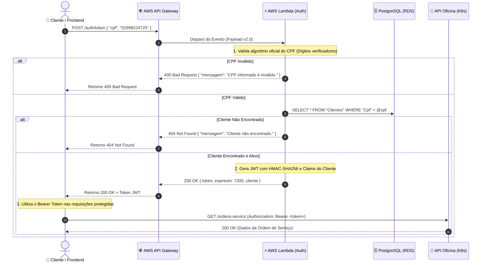

# FIAP Tech Challenge - Serverless Authentication Function (Fase 3)

[](https://github.com/dvdalves/FIAP.Tech.Challenge.Lambda/actions/workflows/ci-cd.yml)

Repositório responsável pela **Function Serverless (AWS Lambda)** de autenticação por CPF e integração com **AWS API Gateway**, atendendo aos requisitos obrigatórios da **Fase 3 do Tech Challenge SOAT - FIAP**.

---

## 🧭 Sumário

1. [Propósito do Repositório](#1-propósito-do-repositório)
2. [Tecnologias Utilizadas](#2-tecnologias-utilizadas)
3. [Arquitetura e Fluxo de Autenticação](#3-arquitetura-e-fluxo-de-autenticação)
4. [Especificação da API](#4-especificação-da-api)
   - [POST /auth/token (ou /auth/login)](#post-authtoken-ou-authlogin)
   - [Códigos de Retorno](#códigos-de-retorno)
5. [Como Executar Localmente](#5-como-executar-localmente)
   - [Execução via .NET CLI](#execução-via-net-cli)
   - [Execução via Docker](#execução-via-docker)
   - [Execução da Suíte de Testes](#execução-da-suíte-de-testes)
6. [Provisionamento da Infraestrutura com Terraform](#6-provisionamento-da-infraestrutura-com-terraform)
7. [Esteira de CI/CD (GitHub Actions)](#7-esteira-de-cicd-github-actions)
8. [Coleção de Testes (Postman)](#8-coleção-de-testes-postman)
9. [Segurança e Governança](#9-segurança-e-governança)

---

## 1. Propósito do Repositório

O principal objetivo desta Function Serverless é desacoplar a autenticação dos clientes do monolito principal, fornecendo uma camada elástica e serverless capaz de:

1. **Validar o CPF do cliente**: Aplicação rigorosa das regras oficiais de formatação e cálculo dos dois dígitos verificadores (Módulo 11) estabelecidas pela Receita Federal do Brasil, descartando requisições com dados inconsistentes antes de onerar a camada de banco.
2. **Consultar o cadastro e status do cliente**: Conexão com o banco de dados gerenciado PostgreSQL (RDS) para verificar a existência e a situação cadastral do cliente na tabela `Clientes`.
3. **Emitir Token JWT Assinado**: Geração de um token JWT contendo as *claims* de identificação (`sub`, `name`, `cpf`, `client_name`, `email`, `role = "Cliente"`, `status`), assinado com chave simétrica HMAC-SHA256 compartilhada com a API principal em execução no Kubernetes.

---

## 2. Tecnologias Utilizadas

| Componente | Tecnologia | Detalhes |
| :--- | :--- | :--- |
| **Linguagem & Runtime** | C# / .NET 10 | Executável otimizado com suporte a AWS Lambda e Minimal API local |
| **Serverless Provider** | AWS Lambda | Execução sob demanda com escalabilidade automática |
| **API Gateway** | AWS API Gateway (HTTP API v2) | Roteamento, controle de CORS, throttling e logs no CloudWatch |
| **Driver de Banco de Dados** | Npgsql 9.x | Conexão de alta performance com pooling assíncrono ao PostgreSQL RDS |
| **Segurança & Criptografia** | JWT (HMAC-SHA256) | `System.IdentityModel.Tokens.Jwt` e `Microsoft.IdentityModel.Tokens` |
| **Infraestrutura como Código** | Terraform (>= 1.5.0) | Provisionamento automatizado do API Gateway, Lambda, IAM Roles e permissões |
| **Conteinerização** | Docker | Imagem multi-stage baseada em Alpine Linux |
| **Testes Automatizados** | xUnit, FluentAssertions, NSubstitute | Cobertura abrangente com testes unitários |
| **CI/CD** | GitHub Actions | Testes, validação Terraform, Docker build e deploy contínuo |

---

## 3. Arquitetura e Fluxo de Autenticação

Abaixo está o diagrama de sequência detalhando o fluxo de validação e emissão de token:



---

## 4. Especificação da API

### POST `/auth/token` (ou `/auth/login`)

Emite um token de acesso para o cliente informado.

#### Headers
```http
Content-Type: application/json
```

#### Corpo da Requisição (Request Body)
```json
{
  "cpf": "52998224725"
}
```
> O CPF pode ser enviado com máscara (`529.982.247-25`) ou apenas números (`52998224725`).

#### Resposta de Sucesso (`200 OK`)
```json
{
  "token": "eyJhbGciOiJIUzI1NiIsInR5cCI6IkpXVCJ9...",
  "tokenType": "Bearer",
  "expiresIn": 7200,
  "cliente": {
    "id": "11111111-1111-1111-1111-111111111111",
    "nome": "Carlos Alberto Silva",
    "cpf": "52998224725",
    "email": "carlos.silva@email.com",
    "telefone": "11987654321",
    "status": "Ativo"
  }
}
```

### Códigos de Retorno

| HTTP Code | Descrição | Exemplo de Retorno |
| :--- | :--- | :--- |
| **`200 OK`** | Autenticação bem-sucedida. Retorna o token JWT e dados do cliente. | `{ "token": "...", "expiresIn": 7200, ... }` |
| **`400 Bad Request`** | CPF mal formatado, dígitos inválidos ou corpo da requisição vazio. | `{ "mensagem": "CPF informado é inválido conforme as regras oficiais.", "statusCode": 400 }` |
| **`404 Not Found`** | CPF válido, porém não cadastrado previamente no banco de dados. | `{ "mensagem": "Cliente não encontrado na base de dados.", "statusCode": 404 }` |
| **`500 Internal Server Error`** | Erro inesperado ao consultar a base de dados gerenciada. | `{ "mensagem": "Falha na comunicação com o banco de dados.", "statusCode": 500 }` |

---

## 5. Como Executar Localmente

### Execução via .NET CLI

A aplicação possui um servidor web local embutido para testes rápidos de desenvolvimento:

```bash
# Executar em modo mock (sem necessidade de banco conectado)
MOCK_DATABASE=true dotnet run --project src/FIAP.Tech.Challenge.Lambda
```

A API estará disponível em `http://localhost:5050` ou na porta informada pelo terminal. Teste com `curl`:

```bash
curl -X POST http://localhost:5050/auth/token \
  -H "Content-Type: application/json" \
  -d '{"cpf": "52998224725"}'
```

### Execução via Docker

```bash
# Construir a imagem localmente
docker build -t oficina-auth-lambda .

# Executar o contêiner
docker run -d -p 8080:8080 -e MOCK_DATABASE=true --name oficina-auth oficina-auth-lambda

# Testar o endpoint
curl -X POST http://localhost:8080/auth/token \
  -H "Content-Type: application/json" \
  -d '{"cpf": "52998224725"}'
```

### Execução da Suíte de Testes

```bash
dotnet test FIAP.Tech.Challenge.Lambda.slnx --verbosity normal
```

---

## 6. Provisionamento da Infraestrutura com Terraform

Os manifests em [`infra/`](infra/) provisionam automaticamente a AWS Lambda, o AWS API Gateway (HTTP API v2), as rotas `/auth/token` e as permissões de invocação IAM:

```bash
cd infra

# 1. Copiar as variáveis de exemplo
cp terraform.tfvars.example terraform.tfvars

# 2. Inicializar o Terraform
terraform init

# 3. Validar o plano
terraform plan -out=tfplan

# 4. Aplicar o provisionamento
terraform apply tfplan
```

### Variáveis de Ambiente Suportadas

| Variável | Padrão | Descrição |
| :--- | :--- | :--- |
| `JWT_SECRET_KEY` | *(chave padrão interna)* | Segredo HMAC-SHA256 para assinatura do JWT |
| `JWT_EXPIRATION_HOURS` | `2` | Validade do token em horas |
| `DB_CONNECTION_STRING` | `""` | Connection string PostgreSQL (formato `Host=...;Database=...`) |
| `MOCK_DATABASE` | `false` | Se `true`, ativa repositório mock para testes isolados |

---

## 7. Esteira de CI/CD (GitHub Actions)

A pipeline implementada em [`.github/workflows/ci-cd.yml`](.github/workflows/ci-cd.yml) é acionada a cada push ou pull request para as branches `main` e `master`:

1. **Build & Testes**: Restaura pacotes, compila o código em .NET 10 e executa todos os testes unitários com coleta de cobertura de código.
2. **Terraform Validation**: Checa a formatação (`terraform fmt -check`) e valida a sintaxe dos manifests (`terraform validate`).
3. **Docker Build**: Constrói a imagem Docker para validar a integridade do empacotamento.
4. **Deploy Automatizado**: Ao mesclar com a branch principal (`main`), compila o pacote de produção e aplica as alterações na AWS via Terraform.

---

## 8. Coleção de Testes (Postman)

Uma coleção pronta para importação no Postman está disponível na raiz:
- [`auth-collection.postman_collection.json`](auth-collection.postman_collection.json)

---

## 9. Segurança e Governança

- **Proteção de Branch**: As branches `main` e `master` são protegidas contra commits diretos, exigindo abertura de Pull Request com aprovação e sucesso na esteira de CI.
- **Acesso Docente**: O usuário de avaliação `soat-architecture` possui permissão de leitura configurada no repositório.
